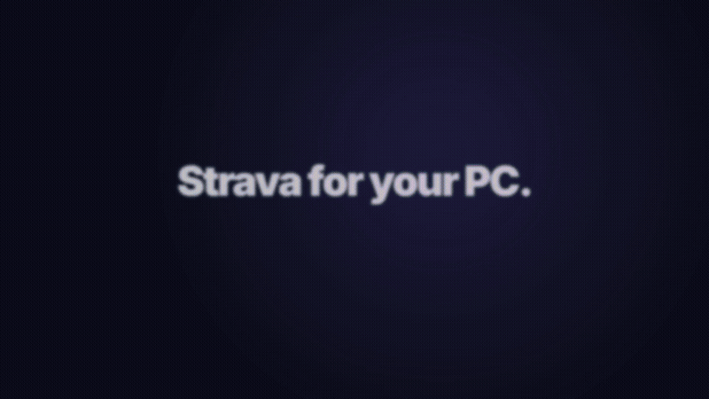
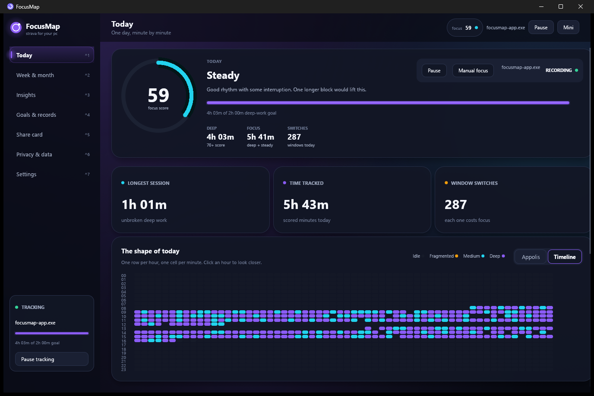
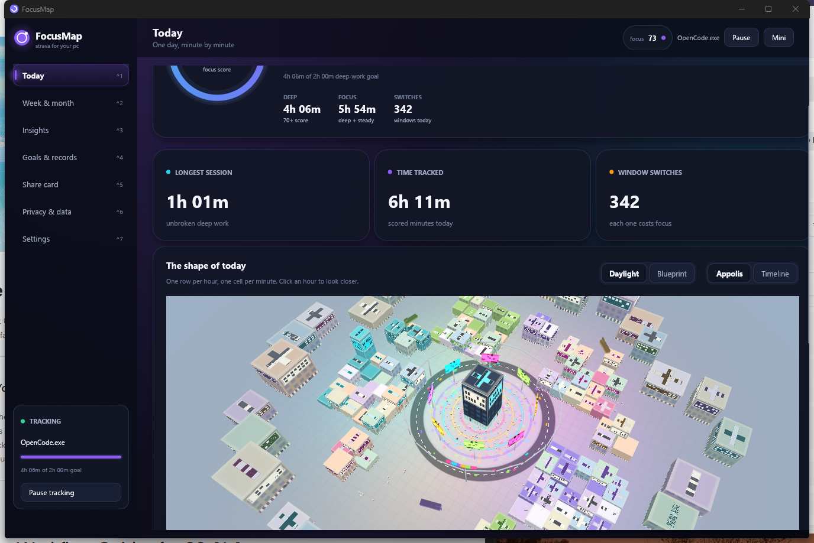

# FocusMap



**Strava for your PC — but the only thing it tracks is how you focus.**

FocusMap is a small Windows app that watches *when* you're working, not *what*
you're doing. It counts your keystrokes and clicks, notes which app is in front,
and turns each minute into a focus score. At the end of the day you get a map of
how the hours actually went — plus a little city that grows out of the apps you
used.

No account. No cloud. Nothing leaves your machine.



## Getting started

Download the installer from the [latest release](https://github.com/harmless-beep/focusmap-desktop/releases/latest)
(`FocusMap-setup.msi`) and run it, or grab `FocusMap.exe` and double-click it.
There's no sign-up and no setup wizard — you can start tracking straight away.

If you'd rather build it yourself, see [Building from source](#building-from-source)
below.

## What you'll find inside

- **Today** — your live score, deep-work minutes, longest unbroken block, and a
  minute-by-minute map of the whole day. Click any hour to zoom in.
- **Appolis** — the fun part. Every app you use becomes a building in one of five
  districts. The taller the tower, the more time you spent there. Hover a tower
  for its stats, click to pin it, or drag the replay slider to watch the day
  rebuild itself. There's a bright daylight view and a cyan **Blueprint** mode;
  after dark the city lights up with neon, rain and a monorail.

  

- **Week & month** — the same story over 7 or 30 days, so you can spot the
  patterns that one day hides.
- **Insights** — your streaks, records, best hours, where your time went, and one
  gentle suggestion based on what's actually been happening.
- **Goals & records** — a daily deep-work goal, your streak, and small nudges
  when you hit it or have been sitting too long.
- **Share card** — two 1080 × 1080 PNGs, drawn locally: a card with your score
  and a snapshot of Appolis. Saved only when you ask.
- **Privacy & data** — a plain list of what's stored, CSV/JSON export, and a
  one-click wipe.

The app also lives in your system tray, so you can pause tracking, open a mini
window, or quit without digging through windows.

## What it does *not* do

This part matters to us:

- It does **not** record what you type. The keyboard hook only counts key events;
  it never reads characters, shortcuts, or the clipboard.
- It does **not** capture window titles, URLs, screenshots, audio, or webcam.
  All it keeps from the foreground app is the executable name, like `Code.exe`.
- It does **not** phone home. There's no server, no analytics, no crash upload,
  and no login. The only thing that ever leaves the app is an optional OS
  notification, and the PNGs and CSVs you choose to save yourself.

## How the score works

Every finished minute gets a score from 0 to 100. Steady input and long stretches
earn points; lots of window switching and short scattered bursts cost them.
Reading and thinking look quiet to a keyboard, so manual focus sessions have a
built-in floor. Games, video, chat and meetings have caps so they can't pass as
deep work.

70+ is **deep**, 45–69 is **steady**, below that is **fragmented**. You can see
and tweak every weight in **Settings → Focus score model**. Changing the weights
affects new minutes; minutes already scored stay as they were.

## Building from source

You'll need Windows 10/11, a recent stable Rust toolchain, and the Visual Studio
C++ build tools. SQLite is bundled, so there's nothing else to install.

```powershell
cargo build --release -p focusmap-app
.\target\release\focusmap-app.exe
```

To poke around without touching your real data:

```powershell
cargo run -p focusmap-app -- --demo   # 45 days of seeded data
cargo test --workspace               # core + city tests
```

`--demo` uses a separate folder in `%TEMP%`, so it never reads or writes your
settings or database. `--minimized` starts the app in the tray.

## Where things are saved

| What | Where |
|---|---|
| Settings | `%APPDATA%\FocusMap\settings.json` |
| Your data | `%LOCALAPPDATA%\FocusMap\focusmap.db` |
| Exports | `%LOCALAPPDATA%\FocusMap\exports\` |
| Share cards | `%USERPROFILE%\Pictures\FocusMap\` |

Old minute rows are compacted after 90 days; the daily summaries stay. The wipe
button clears the data but keeps your settings and goal.

## Shortcuts

| Keys | Action |
|---|---|
| `Ctrl+1` … `Ctrl+7` | Jump between screens |
| `Ctrl+P` | Pause or resume tracking |
| `Ctrl+M` | Start or stop a manual focus session |

The tray menu has pause and open too.

## Notes on performance

FocusMap is meant to sit quietly in the background. With the timeline open it
uses about 0.1% of the machine; with Appolis open at the balanced 30 fps preset
it's roughly 1–2% on a typical laptop. The **Low** preset drops the animated
crowd and traffic. The wgpu/Vulkan stack accounts for most of the memory use
(around 240–315 MB working set in the demo), which is more than a tiny Win32 app
would use — a fair trade for the city.

## License

MIT. See [LICENSE](LICENSE). Made to be private, local, and yours.
